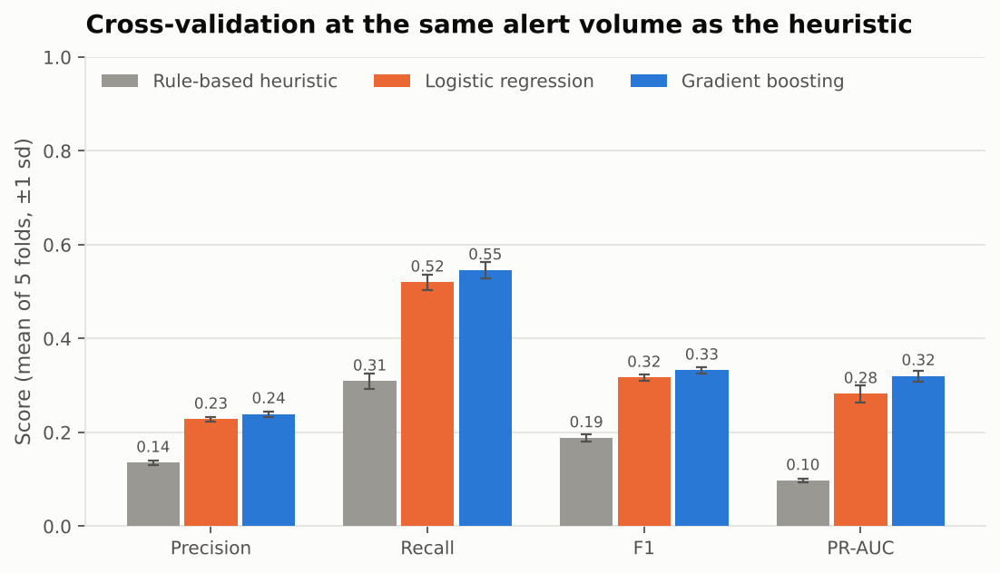
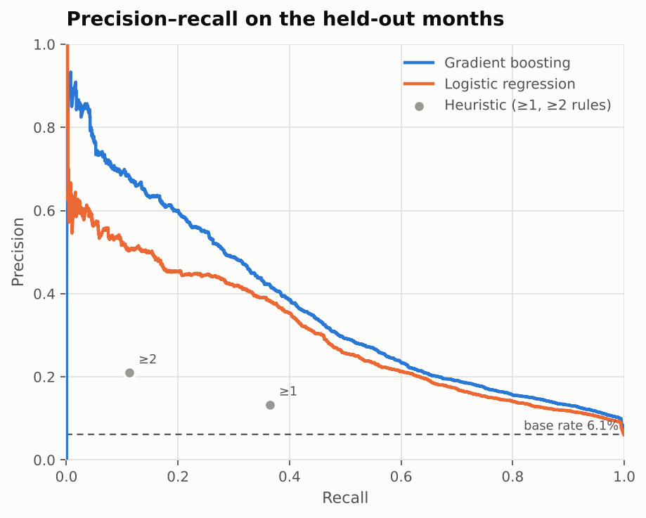
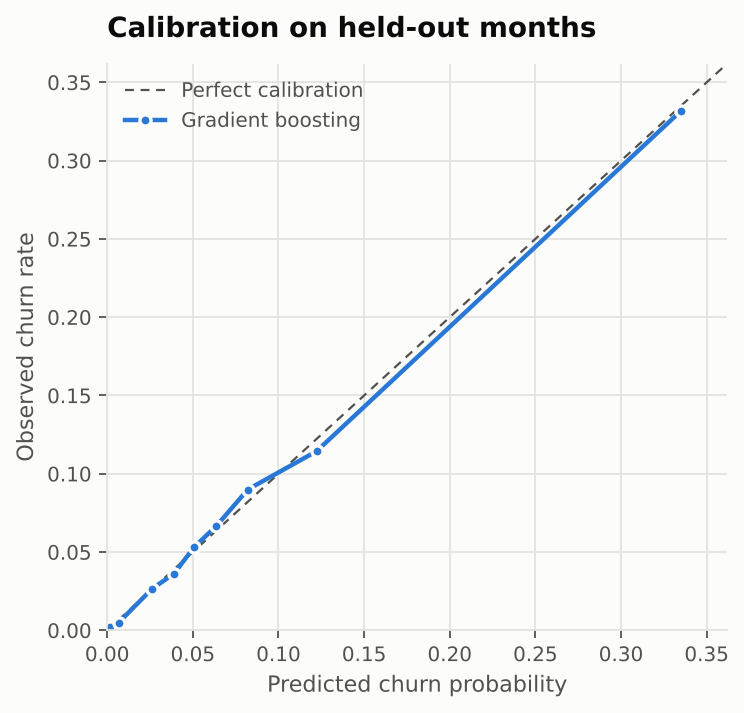
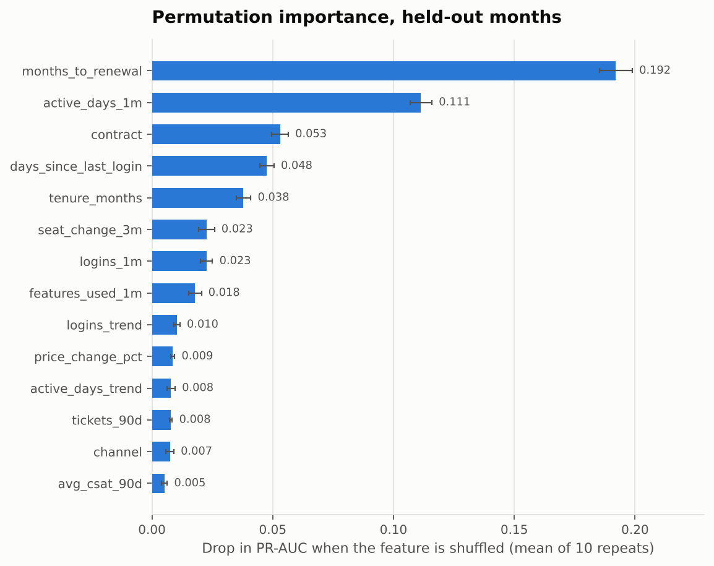
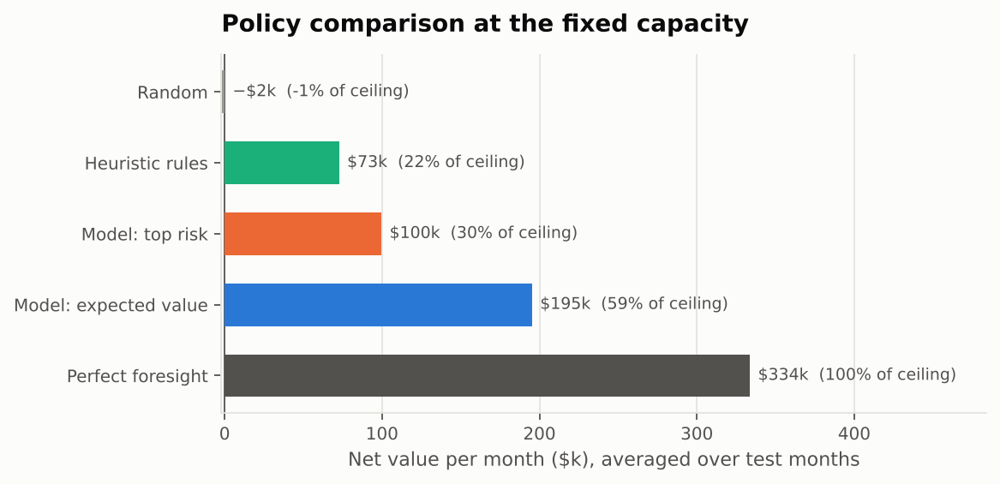
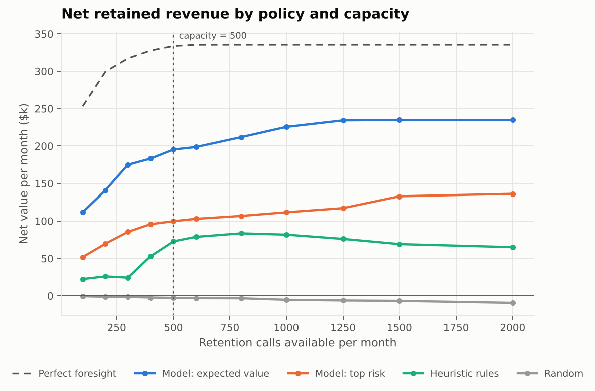

# Predictive & Prescriptive Analytics Model

[](https://github.com/swayam16/Predictive-and-Prescriptive-Analytics-Model/actions/workflows/ci.yml)


**Python · scikit-learn · SQL · Pandas · Matplotlib · Streamlit**

A retention team can make **500 calls a month** to ~9,800 active customers, of whom ~600 will
cancel in the next 60 days. This project answers two questions:

1. **Predictive:** who is about to cancel? A gradient-boosted model built on point-in-time SQL
   features from 24 months of history, validated with customer-grouped cross-validation against
   the team's existing rule-based heuristic, reported on precision, recall, F1 and PR-AUC.
2. **Prescriptive:** given only 500 calls, who should we call? A policy that ranks customers by
   the *expected value* of a call, not raw risk, and solves the capacity constraint exactly.

| Held-out months (Jun to Aug 2026, 29,488 customer-months, 6.1% churn) | Precision | Recall | F1 | PR-AUC | Accuracy |
|---|---|---|---|---|---|
| Always predict "no churn" | 0.000 | 0.000 | 0.000 | 0.061 | **0.939** |
| Heuristic rules (inactive 21+ days, usage halved, or failed payment) | 0.133 | 0.364 | 0.194 | 0.095 | 0.817 |
| **Model, same alert volume as the rules (16.6% of customers)** | **0.224** | **0.616** | **0.329** | **0.364** | 0.848 |
| Model, F1-optimal threshold (chosen on out-of-fold training predictions) | 0.391 | 0.393 | 0.392 | 0.364 | 0.926 |

The first row is why accuracy alone is not reported as the headline: doing nothing scores 93.9%.

| Policy at 500 calls / month (averaged over the 3 held-out months) | Churners reached | Net value / month | Share of ceiling |
|---|---|---|---|
| Random | 30 | −$1.8k | −1% |
| Heuristic rules | 81 | $72.8k | 22% |
| Model, call the highest risk | 214 | $99.7k | 30% |
| **Model, call the highest expected value** | 102 | **$195.4k** | **59%** |
| Perfect foresight (ceiling) | 500 | $333.8k | 100% |

Expected-value targeting reaches *fewer* churners than risk targeting but protects **1.8×** the
revenue: it spends scarce calls on the accounts where a save is worth the most.

> All data is synthetic, generated by `src/churnpolicy/simulate.py`. The model never sees the
> generator's hidden state; it only sees the warehouse tables, as it would in production.

---

## How it works

```
simulate.py ──► SQLite warehouse ──► features.sql ──► features.py ──► CV + holdout ──► permutation
(24 months)     customers             point-in-time    trends, ratios   vs heuristic     importance
                monthly_usage         aggregation per  imputation                            │
                invoices              snapshot date                                          ▼
                support_tickets                                           policy.py: expected value
                cancellations                                             under capacity ──► call list
```

### 1. Data and point-in-time SQL features

Five tables cover 16,000 customers from Oct 2024 to Sep 2026: monthly product usage, invoices
(including failed payments, promos and a list-price increase in Oct 2025), support tickets with
resolution times and CSAT, and cancellations.

A **snapshot** is the 1st of a month. [`sql/features.sql`](src/churnpolicy/sql/features.sql) computes
each active customer's features as of that morning: last-month usage and its trend against the prior
three months, days since last login, seat changes, tickets and high-priority tickets in the last 90
days, failed payments, price change, contract and months to renewal. The label is whether the customer
cancels in the following 60 days.

Leakage is tested, not assumed. [`tests/test_features.py`](tests/test_features.py) deletes every row
dated on or after the snapshot and checks the features don't change, then rewrites the eventual outcome
of tickets still open on the snapshot (resolution time, CSAT) and checks again.

### 2. Validation against a baseline

- **Temporal split.** Train on 13 monthly snapshots (Apr 2025 to Apr 2026), skip May 2026 so no training
  label window overlaps the test period, test on Jun, Jul and Aug 2026.
- **5-fold cross-validation** on the training period with `StratifiedGroupKFold` grouped by customer, so
  no customer appears in both the training and validation side of a fold.
- **Fair comparison.** In every fold the model flags exactly as many customers as the heuristic did, so
  precision and recall are compared at equal workload rather than at a threshold chosen to look good.
- Logistic regression and gradient boosting are both evaluated; gradient boosting wins on CV PR-AUC
  (0.321 ± 0.012 vs 0.282 ± 0.018) and is used downstream.



| 5-fold CV, mean ± sd | Precision | Recall | F1 | PR-AUC |
|---|---|---|---|---|
| Heuristic rules | 0.136 ± 0.005 | 0.309 ± 0.017 | 0.188 ± 0.007 | 0.097 ± 0.003 |
| Logistic regression | 0.228 ± 0.005 | 0.520 ± 0.016 | 0.317 ± 0.006 | 0.282 ± 0.018 |
| Gradient boosting | 0.239 ± 0.006 | 0.546 ± 0.017 | 0.333 ± 0.007 | 0.321 ± 0.012 |



The model is well calibrated on the held-out months (Brier score 0.046), which matters because the
prescriptive step multiplies its probabilities by dollar values.



### 3. Feature contribution: permutation importance

Each feature is shuffled 10 times on the held-out months and the drop in PR-AUC is recorded. Shuffling
the raw column before one-hot encoding gives categoricals such as `contract` a single score.



Months to renewal (34% of total importance) and last-month active days (20%) dominate: annual customers
can only leave at renewal, and disengagement shows up in usage before it shows up in a cancellation.
Contract type, days since last login and tenure follow. Failed payments matter for a small group of
customers but rank low overall, which is why a rule built mostly on them underperforms.

### 4. Prescriptive policy under a fixed capacity

For each customer, the expected value of a call is

```
EV = P(churn in 60 days) × monthly revenue × 12 months × save rate (30%) − cost per call ($40)
```

The decision is: choose at most 500 customers to maximise total EV. Since every call uses one unit of
capacity, this is solved exactly by sorting on EV and taking the top 500 with EV > 0
([`policy.py`](src/churnpolicy/policy.py); [`tests/test_policy.py`](tests/test_policy.py) checks
optimality against brute force). Each policy is back-tested month by month on the held-out period using
only what was known on the 1st, then scored against who actually cancelled.



The capacity sweep shows the expected-value policy stays ahead at every budget, and that its gains flatten
past ~1,250 calls a month: only ~1,450 customers a month have a positive expected value, so the policy
leaves any capacity beyond that unused rather than spend calls that cost more than they save.



The live output is [`reports/call_list.csv`](reports/call_list.csv): the 500 customers to call for
October 2026, scored by a model refit on all labelled months, with an expected net value of $226k.
Two thirds of them would not have been flagged by the old rules.

All of the assumptions (capacity, save rate, cost, horizon) live in [`config.yaml`](config.yaml) and can
be changed live in the demo.

---

## Run it

```bash
git clone https://github.com/swayam16/Predictive-and-Prescriptive-Analytics-Model.git
cd Predictive-and-Prescriptive-Analytics-Model
python -m venv .venv && source .venv/bin/activate
pip install -e ".[dev,app]"

churnpolicy run        # simulate, train, evaluate, write reports/ and artifacts/  (~2 min)
pytest                 # leakage, policy-optimality and end-to-end tests
streamlit run app/streamlit_app.py
```

`churnpolicy run` is deterministic (fixed seeds) and reproduces every number in this README. CI runs it
on every push and fails if the headline metrics drift from the committed `reports/metrics.json`.

### Interactive demo

The Streamlit app has three tabs: the **call list** for the live month (adjust capacity, save rate, cost
and horizon in the sidebar, then download the CSV), a **back-test** of every policy at those settings,
and **model validation** with the metrics and figures above. It reads the committed `artifacts/`, so it
starts instantly.

**Deploy free on Streamlit Community Cloud:** sign in at [share.streamlit.io](https://share.streamlit.io)
with GitHub, choose **Create app → Deploy a public app from GitHub**, pick this repo, branch `main`, main
file `app/streamlit_app.py`, and deploy. It installs from `requirements.txt`.

## Project layout

```
config.yaml                     every parameter: simulation, snapshots, CV, models, policy
src/churnpolicy/
  simulate.py                   synthetic 24-month history -> SQLite warehouse
  sql/features.sql              point-in-time feature query for one snapshot date
  sql/labels.sql                60-day cancellation label
  features.py                   runs the SQL per snapshot, derives trends and ratios
  baseline.py                   the rule-based heuristic
  models.py                     logistic regression and gradient boosting pipelines
  evaluate.py                   grouped CV, matched-volume comparison, holdout report
  importance.py                 permutation importance
  policy.py                     expected value, capacity-constrained selection, back-test
  plots.py                      Matplotlib figures
  pipeline.py, cli.py           `churnpolicy run`
app/streamlit_app.py            interactive demo
tests/                          leakage, labels, policy optimality, end-to-end, app render
reports/                        metrics.json, figures, call_list.csv, capacity sweep
artifacts/                      fitted model and scored customers used by the app
```

## Limitations

- The data is simulated. The structure (warehouse tables, point-in-time features, temporal validation,
  constrained policy) transfers to real data; the specific numbers do not.
- The save rate is an assumption applied uniformly. In practice it should be estimated from a randomised
  holdout of contacted customers, and ideally modelled per customer (uplift modelling), since the best
  customers to call are those a call actually changes, not only those at risk.

## License

MIT
